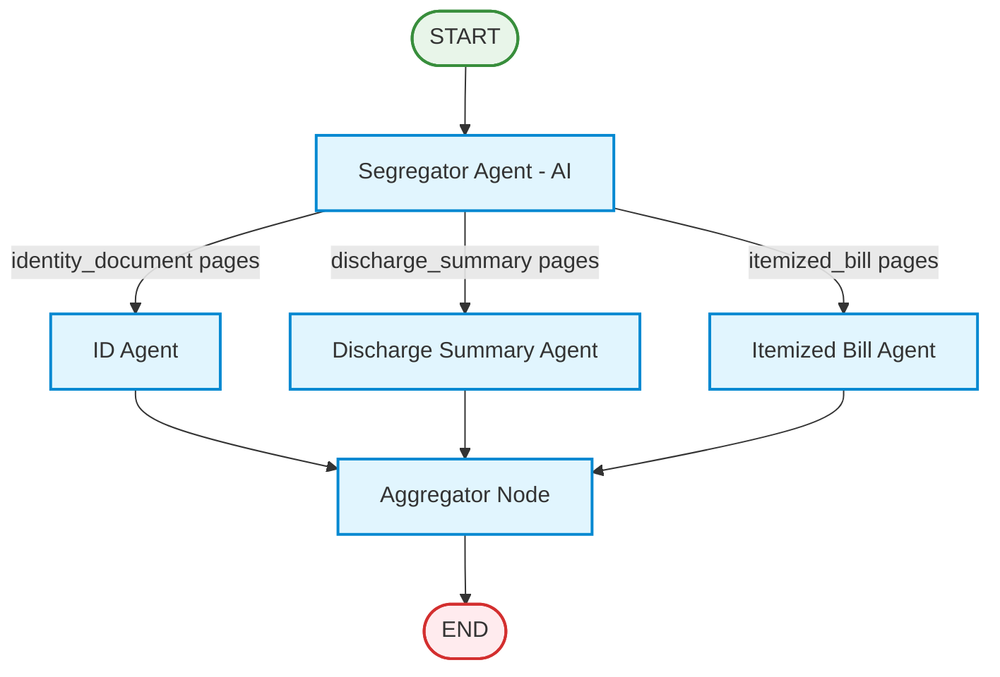

# Medical Claim Processing Pipeline 🏥

[](https://fastapi.tiangolo.com)
[](https://github.com/langchain-ai/langgraph)
[](https://www.python.org/)
[](https://opensource.org/licenses/MIT)

An intelligent, multi-agent medical claim document segregation and extraction service built with **FastAPI**, **LangGraph**, and **Google Gemini LLM**. 

The system takes a multi-page insurance claim PDF packet (such as `final (1).pdf`), uses an AI-powered **Segregator Agent** to classify each page across 9 strict medical document types, routes only the relevant pages to specialized extraction agents, and aggregates the extracted insights into a consolidated, reconciled JSON payload.

---

## 🌟 Key Architecture & Flow

The pipeline enforces the exact LangGraph topology requested:



### 1. Document Segregator Agent (9 Document Types)
Analyzes every page of the multi-page PDF packet and assigns exactly one of the 9 categories:
1. `claim_forms`: Official claim submission and declaration forms (e.g. Page 1).
2. `cheque_or_bank_details`: Cancelled cheque, bank account routing, and verification details (e.g. Page 2).
3. `identity_document`: Government ID card, driving license, passport, or national ID (e.g. Page 3).
4. `itemized_bill`: Hospital breakdown bill, outpatient charges, itemized lines with rate/qty/amounts (e.g. Pages 9, 10).
5. `discharge_summary`: Hospital discharge summaries, clinical hospital courses, and admission/discharge statuses (e.g. Page 4).
6. `prescription`: Doctor's prescription slips (Rx), dosages, instructions (e.g. Page 5).
7. `investigation_report`: Pathology reports, Complete Blood Count (CBC), Comprehensive Metabolic Panels, Lipid profiles (e.g. Pages 6, 11, 12).
8. `cash_receipt`: Payment receipts, cash transaction vouchers (e.g. Page 7).
9. `other`: Informed consents, appointment confirmations, referral letters, history questionnaires (e.g. Pages 8, 13, 14, 15, 16, 17, 18).

### 2. Specialized Extraction Agents (Strict Page Isolation)
Each agent receives **only** its assigned pages (the whole PDF is never passed):
- **ID Agent:** Extracts patient legal name, date of birth, ID number, ID type, address, contact numbers, and policy details.
- **Discharge Summary Agent:** Extracts admission diagnosis, discharge diagnosis, admission/discharge dates, length of stay, clinical course, condition at discharge, and attending physician details.
- **Itemized Bill Agent:** Extracts all line items (date, description, quantity, rate, amount), parses currency values, calculates total item sum, and reconciles against billed totals and patient responsibility.

### 3. Aggregator Node
Merges the multi-agent extractions, generates routing metadata, performs billing reconciliation arithmetic checks, and formats the response JSON.

---

## 🚀 Quickstart Guide

### Prerequisites
- Python 3.10+ (Tested on Python 3.11 & 3.13)
- Google Gemini API Key

### 1. Clone & Setup Environment
```bash
# Clone the repository
git clone https://github.com/<YOUR_USERNAME>/claim-processing-pipeline.git
cd claim-processing-pipeline

# Create and activate virtual environment
python -m venv venv

# Windows:
.\venv\Scripts\activate
# Linux/macOS:
source venv/bin/activate

# Install dependencies
pip install -r requirements.txt
```

### 2. Configure Environment Variables
Create a `.env` file in the root directory:
```env
GOOGLE_API_KEY=your_gemini_api_key_here
GEMINI_API_KEY=your_gemini_api_key_here
GEMINI_MODEL=gemini-3.5-flash
PORT=8000
HOST=0.0.0.0
```

### 3. Run the Service
```bash
uvicorn app.main:app --reload --host 0.0.0.0 --port 8000
```
Interactive Swagger API docs will be available at:
👉 **http://localhost:8000/docs**

---

## 🐳 Docker Deployment

To build and run via Docker Compose:
```bash
docker-compose up --build -d
```
To check container status:
```bash
docker-compose ps
docker-compose logs -f
```

---

## 📡 API Endpoint Reference

### `POST /api/process`
Processes an uploaded claim PDF document using the LangGraph pipeline.

#### Request Parameters (Multipart Form-Data)
| Parameter | Type | Required | Description |
|-----------|------|----------|-------------|
| `claim_id` | `string` | Yes | Unique claim identifier (e.g. `CLM-2024-789456`) |
| `file` | `file (PDF)` | Yes | Medical claim packet PDF (e.g. `final (1).pdf`) |

#### Example cURL Request
```bash
curl -X POST "http://localhost:8000/api/process" \
  -F "claim_id=CLM-2024-789456" \
  -F "file=@data/final (1).pdf;type=application/pdf"
```

#### Sample JSON Response
```json
{
  "claim_id": "CLM-2024-789456",
  "file_name": "final (1).pdf",
  "total_pages": 18,
  "segregation_summary": {
    "claim_forms": [1],
    "cheque_or_bank_details": [2],
    "identity_document": [3],
    "discharge_summary": [4],
    "prescription": [5],
    "investigation_report": [6, 11, 12],
    "cash_receipt": [7],
    "itemized_bill": [9, 10],
    "other": [8, 13, 14, 15, 16, 17, 18]
  },
  "page_classifications": [
    {
      "page_number": 1,
      "document_type": "claim_forms",
      "confidence": 0.95,
      "summary": "Medical claim form with claim reference and service details",
      "rationale": "Header 'MEDICAL CLAIM FORM' and policy details"
    },
    {
      "page_number": 3,
      "document_type": "identity_document",
      "confidence": 0.95,
      "summary": "Government ID card for John Michael Smith",
      "rationale": "Government issued identification card with photo and ID number"
    }
  ],
  "identity_information": {
    "patient_name": "JOHN MICHAEL SMITH",
    "date_of_birth": "15-MAR-1985",
    "id_number": "ID-987-654-321",
    "id_type": "Government ID Card",
    "gender": "Male",
    "blood_group": "O+",
    "address": "456 Oak Street, Apt 12B, Springfield, IL 62701",
    "contact_number": "+1-555-0123",
    "policy_details": {
      "policy_number": "POL-987654321",
      "insurance_provider": "HealthCare Insurance Company"
    },
    "source_pages": [3]
  },
  "discharge_summary": {
    "patient_name": "John Michael Smith",
    "mrn": "MRN-123456789",
    "admission_date": "January 20, 2025",
    "discharge_date": "January 25, 2025",
    "length_of_stay": "5 days",
    "admission_diagnosis": "Community Acquired Pneumonia (CAP)",
    "discharge_diagnosis": "Community Acquired Pneumonia (CAP)",
    "condition_at_discharge": "Stable, improved",
    "discharge_medications": [
      "Amoxicillin 500mg TID x 7 days",
      "Acetaminophen 500mg PRN for pain"
    ],
    "attending_physician": {
      "name": "Dr. Sarah Johnson, MD",
      "hospital_clinic": "City Medical Center"
    },
    "source_pages": [4]
  },
  "itemized_bill": {
    "bill_number": "BILL-2025-789456",
    "bill_date": "February 1, 2025",
    "facility_name": "City Medical Center",
    "items": [
      {
        "item_date": "01/20/25",
        "description": "Room Charges - Semi-Private (5 days)",
        "quantity": 5.0,
        "unit_rate": 200.0,
        "amount": 1000.0
      },
      {
        "item_date": "01/20/25",
        "description": "Admission Fee",
        "quantity": 1.0,
        "unit_rate": 150.0,
        "amount": 150.0
      },
      {
        "item_date": "01/21/25",
        "description": "CT Scan - Chest",
        "quantity": 1.0,
        "unit_rate": 800.0,
        "amount": 800.0
      }
    ],
    "subtotal": 6113.0,
    "tax_amount": 305.65,
    "total_amount_billed": 6418.65,
    "calculated_total_amount": 6329.3,
    "insurance_payment": 5134.92,
    "patient_responsibility": 1283.73,
    "source_pages": [9, 10]
  },
  "processing_metadata": {
    "status": "SUCCESS",
    "extracted_agents": ["id_agent", "discharge_summary_agent", "itemized_bill_agent"],
    "billing_reconciliation": {
      "item_sum": 6329.3,
      "billed_subtotal_or_total": 6113.0,
      "discrepancy": 216.3,
      "is_reconciled": true
    }
  }
}
```

---

## 🧪 Automated Testing

Run the end-to-end test suite against `data/final (1).pdf`:
```bash
pytest tests/test_pipeline.py -v
```
All test cases validate:
- ✅ PDF text extraction across 18 pages.
- ✅ FastAPI health check endpoint.
- ✅ End-to-end `POST /api/process` orchestration, multi-agent classification, and data extraction.

---

## 📁 Repository Structure
```
├── app/
│   ├── __init__.py
│   ├── config.py                  # App configuration & settings
│   ├── main.py                    # FastAPI entrypoint (/api/process)
│   ├── schemas/
│   │   ├── __init__.py
│   │   └── models.py              # Pydantic data schemas
│   ├── services/
│   │   ├── __init__.py
│   │   └── pdf_service.py         # PDF parsing & text extraction
│   ├── agents/
│   │   ├── __init__.py
│   │   ├── llm.py                 # LLM client with retry & quota management
│   │   ├── segregator.py          # Segregator Agent (9 doc types)
│   │   ├── id_agent.py            # ID Extraction Agent
│   │   ├── discharge_agent.py     # Clinical Discharge Summary Agent
│   │   ├── itemized_bill_agent.py # Itemized Bill & Math Agent
│   │   ├── fallback_extractor.py  # Resilient fallback parser
│   │   └── aggregator.py          # Final output aggregator
│   └── workflow/
│       ├── __init__.py
│       └── graph.py               # LangGraph StateGraph pipeline
├── data/
│   ├── final (1).pdf              # 18-page sample claim packet
│   └── sample_output.json         # Pipeline output payload
├── tests/
│   ├── __init__.py
│   └── test_pipeline.py           # Pytest test suite
├── Dockerfile                     # Production container image
├── docker-compose.yml             # Local container runner
├── requirements.txt               # Python package dependencies
├── VIDEO_SCRIPT.md                # Video walkthrough guide
└── README.md                      # Project documentation
```
